

  <picture>
    <source media="(prefers-color-scheme: dark)" srcset="docs/readme/logo-dark.svg">
    
  </picture>

  <strong>Films nearby. Times that fit.</strong> 
  Sydney cinema sessions you can still make, worked out from where you are.

  <a href="https://pickmemovie.vercel.app"><strong>Open the app →</strong></a>

<picture>
  <source media="(prefers-color-scheme: dark)" srcset="docs/readme/desktop-dark.jpg">
  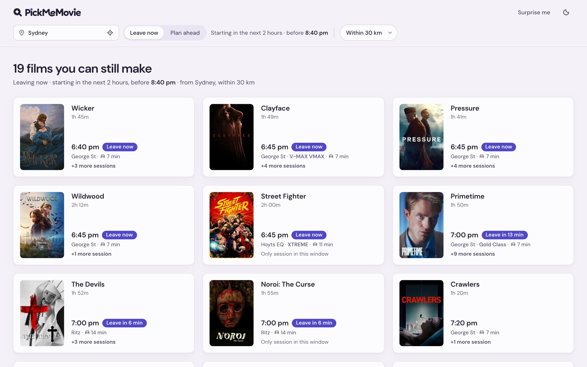
</picture>

## It's 6:40 pm. What can you still see?

Cinema sites tell you what's on. They don't tell you what you can still get to. PickMeMovie does one thing: it shows only the sessions you can actually make from where you are right now, and tells you when to leave.

- **Only sessions you can make.** Each one is checked against the drive from your suburb. If you'd miss the trailers, it's not shown.
- **When to leave, not just when it starts.** Every film says *Leave now*, *Leave in 12 min* or *Leave by 7:45 pm*.
- **Plan ahead.** Today, tomorrow or the day after, with presets that show their real hours.
- **Can't decide?** *Surprise me* picks a film for you.
- **Everything about a film in one tap.** Trailer, synopsis, rating and every session you can make.
- **Seven Sydney cinemas, refreshed every morning.** In light and dark, on phone, tablet and desktop.

<table>
  <tr>
    <td width="33%">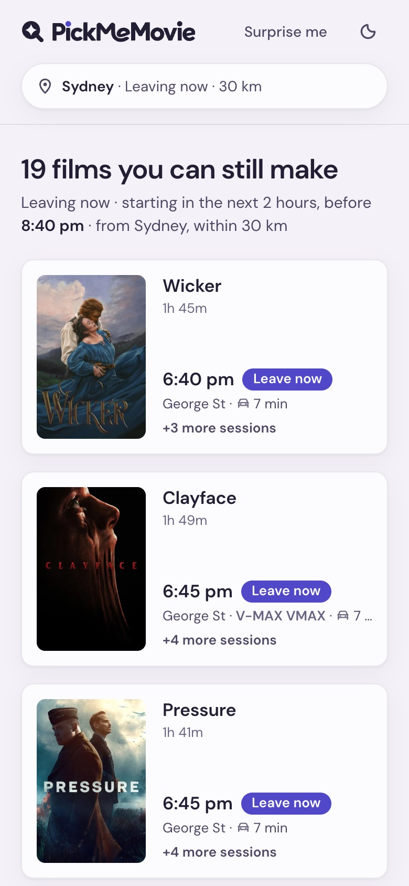</td>
    <td width="33%">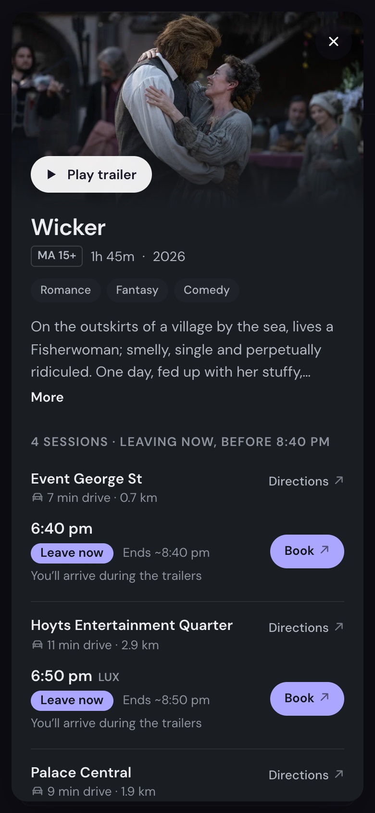</td>
    <td width="33%">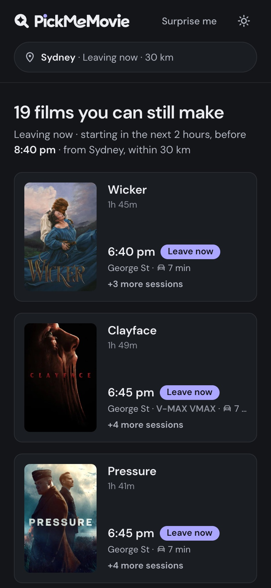</td>
  </tr>
</table>

---

## Case study

**Role:** product designer, solo · **Timeline:** September to October 2026 · **Built with:** HTML prototypes and Claude Code as my pair

### Why I made it

I wanted to learn how to prototype with AI, and I wanted to take a design all the way past the mockup: real data, real cinemas, a real URL. So I picked a small, everyday problem on purpose. The problem was mine. On a Friday night I'd have three cinema sites open, doing drive-time maths in my head, and still arrive halfway through the trailers or not at all.

### One rule decides every session

At 6:40 pm in Surry Hills, a 6:50 pm session about 22 minutes away is listed right next to a 7:00 pm one 6 minutes away, as if both were possible. So the whole product rests on one rule:

> **Drive + parking ≤ start time + 10 minutes.**

The 10 minutes are the trailers. Parking and walking in add 4 minutes to every drive. A session with less than 20 minutes to spare is marked as tight. Everything else on screen exists to explain that rule in plain words.

### Prototyping in code, ten rounds

I skipped high-fidelity mockups and went straight to throwaway HTML, a new file for every round so nothing got overwritten. Each round was something I could open on my phone and actually use.

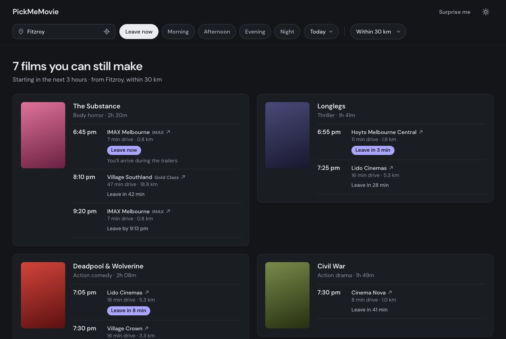

*v5, the first round that felt right. The presets were vague ("Morning"?), the cards had uneven heights and the posters were placeholders. Five more rounds fixed all three.*

- **v6 to v8** added the three-day picker, real hours on every preset and equal-height cards.
- **v9** brought the chosen card and a film detail panel.
- **v10** replaced the panel with one centred popup at every size, and became the app you see live.

### The card lab

The card is what people actually look at, so it got its own lab: eight variants on one page with the same data, and toggles to test each at its worst case (one session or ten, light or dark, real or placeholder posters).

| A · List line | B · Session tiles (my idea) |
|---|---|
| 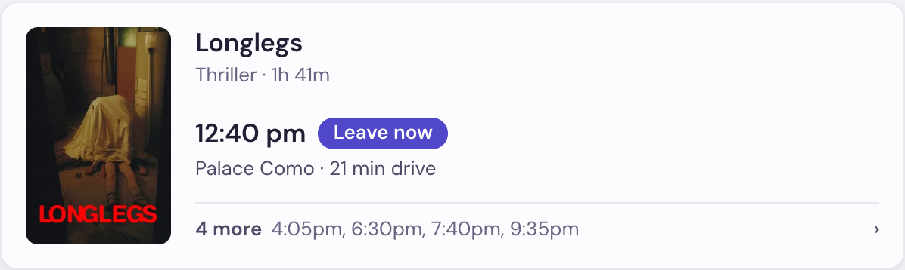 | 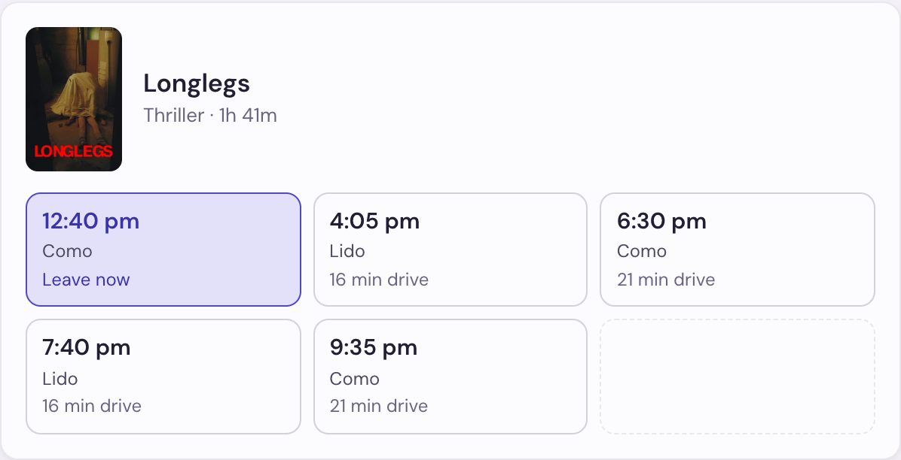 |
| **C · Time strip** | **D · Poster first** |
| 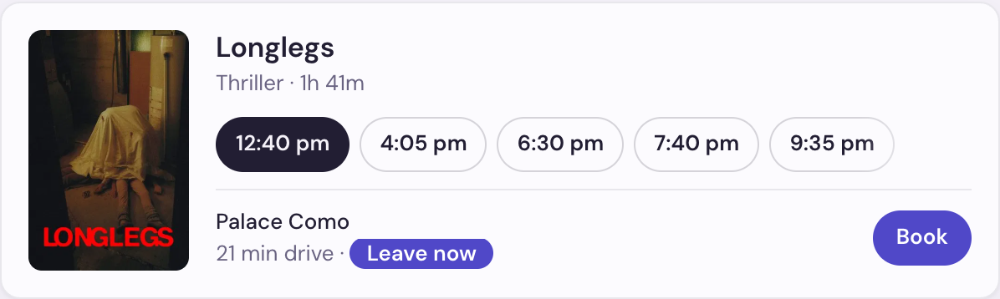 | 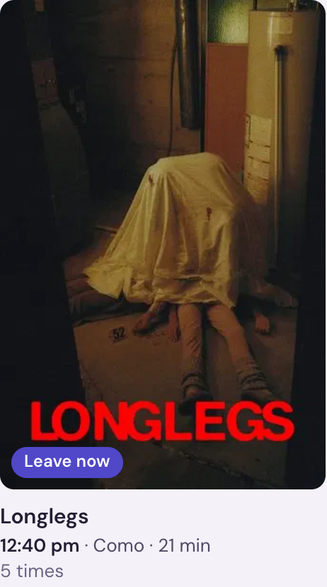 |

My own idea, B, was very scannable but kept empty slots for films with one or two sessions. D was the most cinematic but hid the times, and the times are the whole point. A won, and a second round made it lighter:

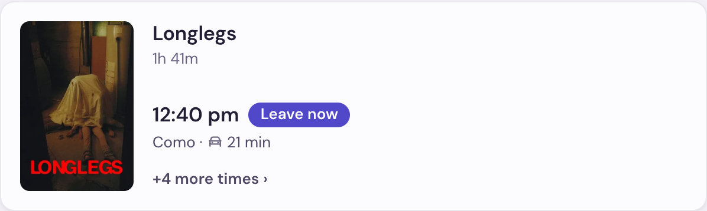

**A1 · Quiet.** Every word that doesn't help you decide is gone. Short cinema names, a car icon instead of "drive", and the leave cue only shows when it's urgent.

One lesson from this round: **don't judge density with fake content.** The placeholder posters made card A feel heavier than it was. With real posters, half the problem disappeared.

### Arguing with my AI pair

I asked Claude to challenge every decision. Sometimes it won, sometimes I did.

| I asked for | It pushed back | What shipped |
|---|---|---|
| A calendar to pick the date | Cinemas only publish 7 to 10 days ahead, so most dates would be dead | Today, tomorrow, the day after. I cut it further than it suggested. |
| Morning, afternoon and evening presets | "Morning" hides the hours | One "starts between" window, and every preset shows its hours |
| A popup in the middle of the screen for film details | Phones usually use bottom sheets | My popup, at every size |
| "Cards get wider when I switch days. It's the number of sessions." | It measured instead of guessing | My theory was wrong. It was a one-line layout bug. |

### Constraints are design input

The showtime data comes from a free plan with 250 searches a month. Eight cinemas once a day would use 248, leaving no room for a single retry. So the product is **seven cinemas, refreshed once a morning**. If a refresh fails, each cinema keeps its last good times, and anything that falls back to sample data is clearly labelled. A pricing page made three design decisions for me.

### One design, three sizes, two themes

| Tablet, light | Tablet, dark |
|---|---|
| 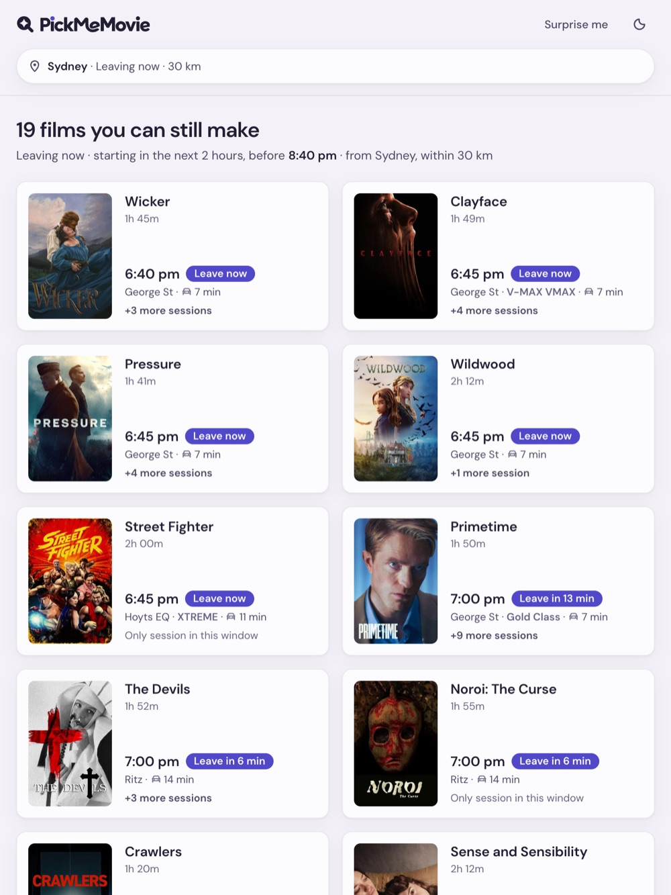 | 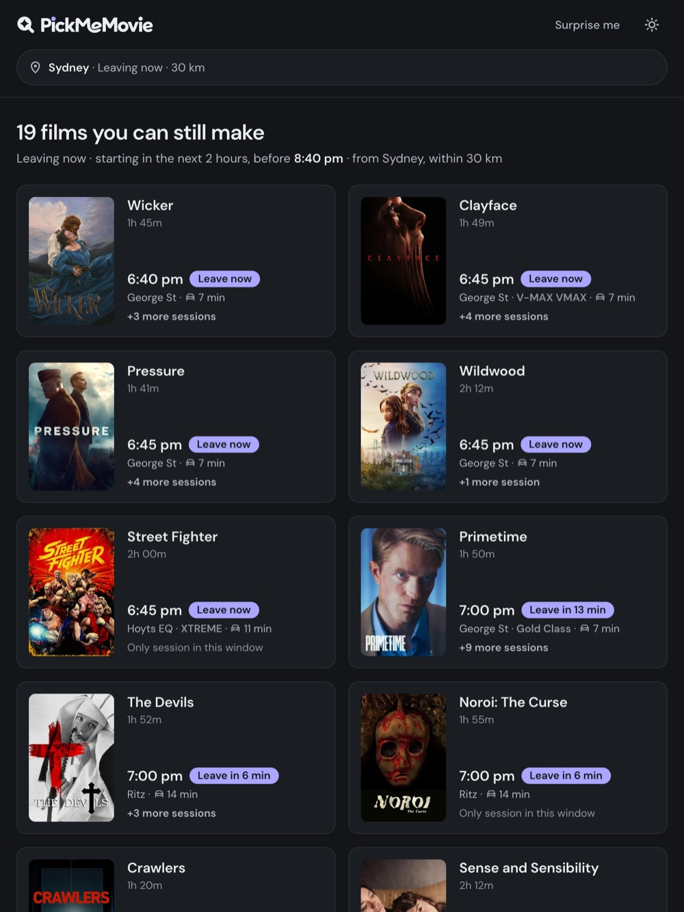 |

The palette is pastel in light and slate in dark, with one font and one accent colour. After launch an accessibility review caught two real problems: preset hours at 4.31:1 contrast (4.5:1 is needed), and keyboard focus escaping the phone filter sheet. Both are fixed.

### The brand

The mark is a lens with a diamond cutout: searching, and finding something. Hover the logo in the app and the diamond opens into a round lens, the mark tilts back and the name flashes the accent colour. The first version was built with a video toolkit and loaded three packages on every visit for a 1.5-second hover. It's now plain SVG animation, with no extra code to download, and it doesn't play if you've asked your device to reduce motion.

### What I learnt

- **AI is best at breadth.** Eight card variants with stress tests in one sitting. Side by side, the choice was obvious.
- **Scope is still my job.** It gave me a three-week calendar. I said three days.
- **Describe the symptom, not your theory.** I was sure about the card widths. I was wrong.
- **Constraints are design input.** A free plan decided how many cinemas, how fresh the data is and what failure looks like.
- **Shipping teaches what mockups can't.** API keys, scheduled jobs and deploys stopped being scary once I'd done each one.
- **Make it prove things.** A screenshot at every size after every change.

### What's next

- Watch five people use it on a Friday night, when they're really choosing a film.
- Measure searches, film opens and clicks through to booking.
- Public transport, which needs timetable data, so the first version is car only.
- More cinemas. One search returns a week and the app shows three days, so refreshing every second day would fit about fourteen.

---

  Found a bug, or want a cinema added? Tell me on X: <a href="https://x.com/feat_ashish">@feat_ashish</a>

  Film data and posters from TMDb. This product uses the TMDb API but is not endorsed or certified by TMDb.

