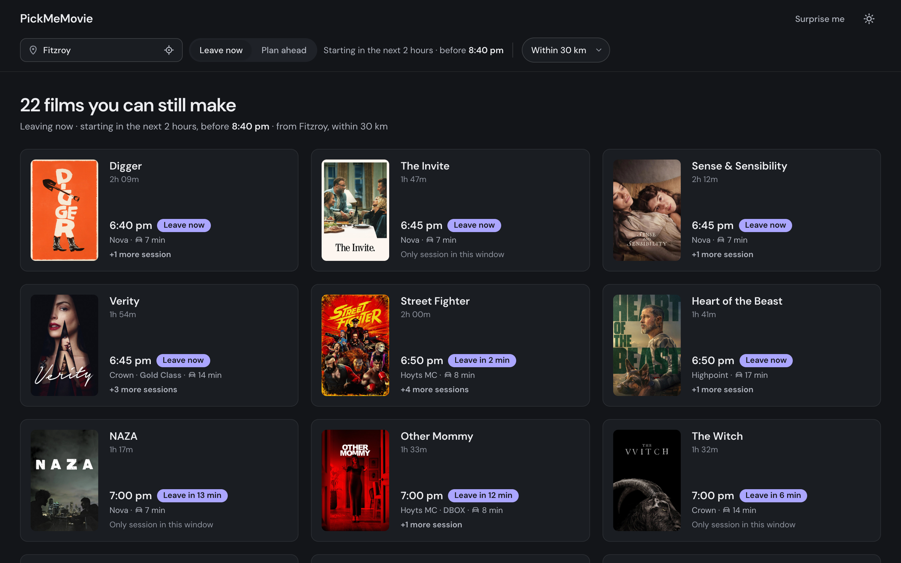
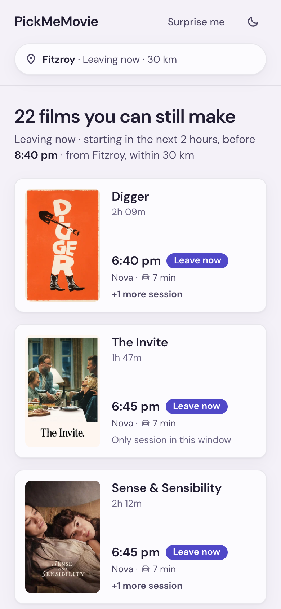
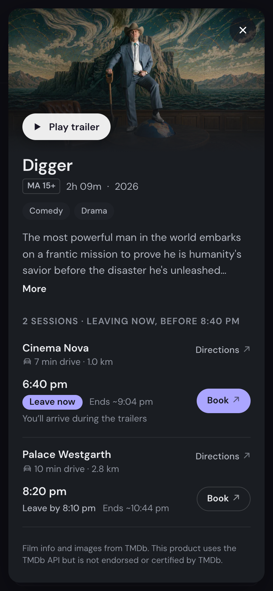
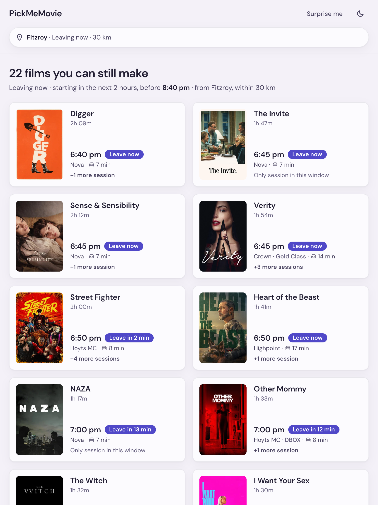

# PickMeMovie: what can I still make tonight?

A Melbourne showtime finder that only shows the sessions you can still get to. I designed, prototyped and shipped it, with Claude Code as my pair.

**Role:** junior product designer, solo
**Timeline:** September to October 2026
**Built with:** HTML prototypes, Figma, Claude Code, Next.js, Vercel, TMDb, Geoapify, SerpAPI
**Live:** [pickmemovie.vercel.app](https://pickmemovie.vercel.app) · **Code:** [github.com/dedkul/pickmemovie](https://github.com/dedkul/pickmemovie)
**Deck:** [Figma, page 06 · Case study](https://www.figma.com/design/UWsVpX6D5IQsqTTNWPgj7Q)

---

## Why I made this

I wanted to learn how to prototype with AI. So I picked a simple, everyday problem and pushed it past Figma, all the way to real data, real APIs and a real URL. The problem is small on purpose. The workflow is what I came to learn.

- **Prototype in code.** Ten rounds of static HTML before a single line of app code.
- **Design with a partner.** Claude Code as my pair, with standing permission to challenge every decision I made.
- **Ship it for real.** APIs, a daily data refresh and hosting on Vercel, three things I had never touched before.

## The problem

Cinema sites tell you what's on. They don't tell you what you can still make. At 6:40 pm in Fitzroy, a 6:50 pm session at Hoyts Chadstone (about 25 minutes away) is listed next to a 7:00 pm one at Cinema Nova (7 minutes away), as if both were possible.

**One rule decides every session:** drive + parking ≤ start + 10 min. Drive times come from Geoapify, plus 4 minutes to park and walk in. The 10 minutes are the trailers. Each film then says *Leave now*, *Leave in 12 min* or *Leave by 7:45 pm*.

## How I worked with Claude

1. **Prototype in throwaway HTML first.** Every round is a new file, v5 to v10, so nothing gets overwritten.
2. **Let it push back.** Every brief asked Claude to challenge my decisions and to ask instead of guessing.
3. **Keep the rules in the repo.** `CLAUDE.md` holds how we work; a memory file holds what we decided.
4. **I describe symptoms, it proves causes.** Fixes are checked with screenshots and measurements.
5. **Variants, then a decision.** When I was unsure, Claude built options side by side and I chose.

## Process

**Ten rounds of HTML (v5 to v10).** v5 was the first that felt right. v6 to v8 added the three-day picker, real hours on every preset and equal-height cards. v9 brought the chosen card and a film detail panel. v10 replaced the panel with one centred popup at every size.

**The card lab.** Eight card variants on one page with the same data, tested at their worst case (Appendix B). Round one tried a list, tiles, a time strip and poster-first; the list won. Round two made it lighter, and I chose **A1 · Quiet**. Lesson: don't judge density with fake content.

**Where Claude pushed back, and who won**

| I asked for | Claude pushed back | What shipped |
|---|---|---|
| A calendar to pick the date | Cinemas only publish 7 to 10 days ahead | Today, Tomorrow, day after. I cut it further than Claude did. |
| Morning / afternoon / evening presets | "Morning" hides the hours | One "starts between" window; every preset shows its hours |
| A centred popup instead of the side panel | Phones usually use bottom sheets; worth a usability test | My popup, at every size |

**From mock data to a real app.** Google showtimes through SerpAPI → a daily Vercel Cron job → a saved snapshot in Vercel Blob → the Next.js app, with TMDb for films and Geoapify for drive times. The free plan's 250 searches a month set the scope: eight cinemas would use 248, leaving no room for a retry, so it's **seven cinemas once a day** (217). If a refresh fails, each cinema falls back to its last good copy, then to clearly labelled sample times.

## One design, three sizes, two themes

| Phone | Phone, film detail | Tablet |
|---|---|---|
|  |  |  |

## What I learnt

- **AI is best at breadth.** Eight card variants with stress-test toggles in one sitting. Side by side, the choice was obvious.
- **Scope is still my job.** Claude gave me a three-week calendar. I said three days.
- **Describe the symptom, not your theory.** I was sure cards changed width because of their session count. Claude measured it and found a one-line CSS bug.
- **Constraints are design input.** A free plan decided how many cinemas, how fresh the data is and what the fallback looks like.
- **Shipping teaches what Figma can't.** API keys, environment variables, scheduled jobs and deploys stopped being scary once I'd done each one.
- **Make it prove things.** Screenshots at every size after every change.

## Next

- Public transport (needs a transit API and timetables, so v1 is car only).
- A usability test of the centred popup on phones.
- Sessions just after midnight from the night before.

---

## Appendix A · Decision log

| # | What I asked for | What the AI pushed back with | What we chose, and why |
|---|---|---|---|
| 1 | A calendar instead of "Today ▾" | Cinemas only publish about 7–10 days ahead, so a month view is mostly dead dates | v6: a 3-week calendar with unpublished days greyed out. **Then I cut it to 3 days** (Today / Tomorrow / day after) as a segmented control. The product is about *soon*, not *someday*. |
| 2 | "How does anyone know what *morning* means?" | Labels hide the hours. Also, combining separate slots ("morning + evening") can't be summed up honestly in one line | One continuous **"starts between X and Y"** window. Presets show their hours ("Evening, 5–9 pm"), and the summary always spells out date and hours. Presets that are already over today are disabled, with a plain-language note. |
| 3 | Leave now = 1 hour (I first had 3) | One hour leaves most cards with a single session, and a quiet suburb at 3 pm often shows nothing | **2 hours.** Leave now became its own mode next to Plan ahead, and it states its window: "starting before 9:40 pm". |
| 4 | — (raised by the AI) | Some sessions start at 12:15 am but are listed under the day before. A hard midnight cut-off would quietly hide them | "Late" runs **9 pm – 1 am**. After-midnight sessions count under the night you go out and are labelled "after midnight". |
| 5 | Let Surprise me pick a timing | Don't add a second set of filters | A **Leave now / your search** switch inside the pick itself. Any option with nothing in it is greyed out. |
| 6 | Should we support public transport? | Easy UI, hard data: needs a transit routing API, timetable-aware times and handling of transfers | **Car only for v1.** Everything says "drive" so nobody reads it as a public transport time. Public transport is a later phase. |
| 7 | — (raised by the AI) | Typing your suburb on every visit is friction | Remember the last location **on the device only**. |
| 8 | Equal card heights | Uneven heights come from uneven content, so give every card the same anatomy | v6: soonest session plus one "N more" line that opens a sheet. Every grid row is forced to the same height. |
| 9 | "Cards get wider when I switch days. I think it's the number of sessions" | **My diagnosis was close but wrong.** The real cause was CSS: plain `1fr` grid columns grow to fit text that can't wrap | One-line fix (`minmax(0, 1fr)`). It was measured, not eyeballed: v7 widths varied (for example 448 px vs 346 px in the same grid); v8 is identical at every size tested. |
| 10 | Card A is best but text-heavy | Some of that heaviness comes from the placeholder posters. Test with real ones first | Pulled the real TMDb posters into the lab, then explored four lighter versions of A (Appendix B). |
| 11 | Can SerpAPI make it a real app, not just mock data? | Tested first: one search per cinema returns 7 days (~18 films, ~50 sessions a day, with formats like LUX and DBOX). But the free plan is 250 searches a month | Cinemas refreshed **once a day**, cached, so visitors cost nothing, with a fallback if the quota runs out. First planned as 8 cinemas; cut to 7 in decision 19. |
| 12 | A trailer, without adding complexity | TMDb already returns YouTube trailers in the same call as the film details | A **"Watch trailer"** link in the film detail only. The cards stay clean. |
| 13 | Genres and details from TMDb | The same call also gives runtime, poster and the Australian rating (e.g. MA 15+) | One cached TMDb lookup per film, matched by title from the showtimes data. |
| 14 | Final card: A1 (keep A3 around) | AI recommended A3 + A1's urgent-only rule; I chose A1 for its minimalism | **A1 Quiet** in v9. A3 stays in the lab as a possible refinement. |
| 15 | "+6 more times" is the wrong word | Agreed. Australian cinemas (Hoyts, Village) call them **sessions**, not showtimes or times | UX copy pass: "sessions" everywhere, "Only session in this window", and a friendlier empty state ("Nothing fits these filters. Try one of these:"). |
| 16 | Trailer and synopsis, but behind a click | Competitive look (IMDb, MUBI GO, Roku, Plex, CGV on Mobbin): film pages lead with a hero plus a Trailer action, and group sessions by cinema. None tell you when to leave | The **whole card opens a film detail view**: a full-screen sheet on phones, a side panel on desktop. It has a backdrop with "Play trailer", the AU rating, runtime, genres, a 3-line synopsis with "More", and sessions grouped by cinema with **estimated end time**, **Directions** and **Book**. The phone back button closes it. |
| 17 | "Show the details in a popup in the middle of the screen, not a sidebar. Better for mobile too" | Phones usually use bottom sheets or full screen, and a centred popup gives up about 24 px of height. Worth checking in a usability test | **v10: one centred popup at every size** (max 640 px wide). The hero with close and trailer stays pinned, and only the details scroll. One component instead of two layouts. Surprise me now opens the same way. v9 is kept as the iteration. |
| 18 | "Switching Leave now / Plan ahead nudges the whole page sideways. It feels sloppy" | Right diagnosis: the scrollbar appears and disappears, so the page width changes by 15 px. **The textbook fix (`scrollbar-gutter: stable`) didn't hold up when measured** in Chrome, so we didn't ship it | The page always keeps its scroll track, and popups pad for the scrollbar's exact width while they're open. Measured: v9 moved 7.5 px on a wide screen; v10 stays at the same pixel in every state. |
| 19 | Build plan: 8 cinemas | 8 × 31 days = 248 of 250 searches, with no room for a single retry | **7 cinemas** (217 searches a month). Dropped IMAX Melbourne, Palace Como and Village Southland; kept a spread from the CBD to Highpoint and Chadstone. |
| 20 | Keep the prototype's look in the real app | The original plan said Tailwind, which meant restyling everything and drifting from v10 | **Port the v10 CSS as it is** and remove Tailwind. The live app matches the approved prototype. |
| 21 | — | Drive times from the routing API assume no traffic and end at the door | **4 minutes for parking and walking in** are added to every drive, and a session counts as "tight" with under 20 minutes to spare. |
| 22 | The poster on the phone card looks off | Measured: 15 px above the poster, 31 px below | Poster 84 → **104 px** so it sits with an even 15 px all round. The first fix after launch. |

## Appendix B · The card exploration

The card is what people actually look at, so it got its own lab page (`prototypes/cards.html`). Every variant renders the same data. Toggles switch between few and many sessions, the three days, light and dark, and real versus placeholder posters, so each design is tested at its worst case, not its best.

**Round 1: four directions**

| A · List line | B · Session tiles (my idea) |
|---|---|
|  |  |
| **C · Time strip** | **D · Poster first** |
|  |  |

- **B** was my sketch idea. It's very scannable, but it reserves room for six tiles, so films with one or two sessions show empty slots.
- **C** was the AI's pick: compact, and every session is reachable inside the card.
- **D** is the most film-first, but it hides the times, and times are the whole point of the product.
- I preferred **A**.

**Real posters versus placeholders**

| Placeholder | Real TMDb poster |
|---|---|
|  |  |

**Round 2: lighter versions of A**

| A1 · Quiet | A2 · Time-led |
|---|---|
|  |  |
| **A3 · A + chips** | **A4 · Timeline** |
|  |  |

- **A1:** cut every word that isn't needed to decide. Short cinema names, a car icon instead of "drive", and the urgent cue only when it's urgent.
- **A2:** fix the hierarchy instead of the word count. The time is the hero.
- **A3:** the other times as tappable chips that swap into the main slot.
- **A4:** a timeline of ticks: the least text, but vague.

**v10 at tablet and phone (light)**

| Tablet | Phone |
|---|---|
|  |  |

---

*Film data and posters from TMDb. This product uses the TMDb API but is not endorsed or certified by TMDb.*
