# PickMeMovie: designing with AI in the loop

> **Draft.** Built from the working sessions and the prototypes in `/prototypes`. Lines marked ✏️ need your own words or a check before this goes on the portfolio.

**Role:** UI/UX designer and developer (solo)
**Tools:** Claude Code (AI pair), static HTML prototypes, Next.js, TMDb, Geoapify, Vercel
**Status:** Front-end design almost final. The card design is the last open decision.
**Design file:** [Figma: PickMeMovie Design Iterations](https://www.figma.com/design/UWsVpX6D5IQsqTTNWPgj7Q) (Versions, Card exploration, Decision log, Film detail iteration and Responsive screens pages)

---

## 1. The problem

Cinema websites tell you *what's on*. They don't tell you *what you can still make*. If I'm in Fitzroy at 6:40 pm, a 7:00 pm session in Chadstone is listed, but it's useless to me.

PickMeMovie answers one question: **"I'm free now, or in this window. What can I actually get to?"** Every session is checked against travel time plus a 10-minute trailer buffer. Each result then says *leave now*, *leave in 12 min* or *leave by 7:45 pm*.

## 2. How I worked with AI

I didn't want "AI, build me an app". I wanted a workflow where I stay the designer and the AI speeds up the parts that are slow for one person.

**The ground rules I set up:**

1. **Prototype in throwaway HTML before writing any real code.** Every round is a new single file (`v5.html` → `v8.html`), so I can compare versions and nothing gets overwritten.
2. **Give the AI permission to push back.** In every brief I asked it to challenge my decisions, and to ask questions when it had gaps instead of guessing.
3. **Rules in the repo, not in my head.** A `CLAUDE.md` file holds the engineering rules: surgical changes, read before writing, "fail loud", and token budgets. A persistent memory holds the design direction and past decisions, so each session starts from where the last one stopped.
4. **I describe symptoms; the AI finds causes, and it has to prove them.** It checks its work with headless screenshots and measurements, not "looks fine to me".
5. **Variants, then a decision.** When I'm unsure, the AI builds several options in a single "lab" page with stress-test toggles, and I choose.

✏️ *A sentence on why you set it up this way: what you were afraid AI would do badly, and what you hoped it would do well.*

## 3. Where it started

Earlier rounds (v3–v4, not kept) set the visual direction:
- one typeface (DM Sans)
- a pastel lavender light theme and a slate dark theme
- one accent colour, used only for "act now"

I tried and dropped a serif display font, amber accents and glassmorphism. ✏️ *Check this list against your memory of those rounds.*

**v5** was the first version that felt right: a film-first grid with live reachability against the real clock. Reviewing it, I had four complaints:

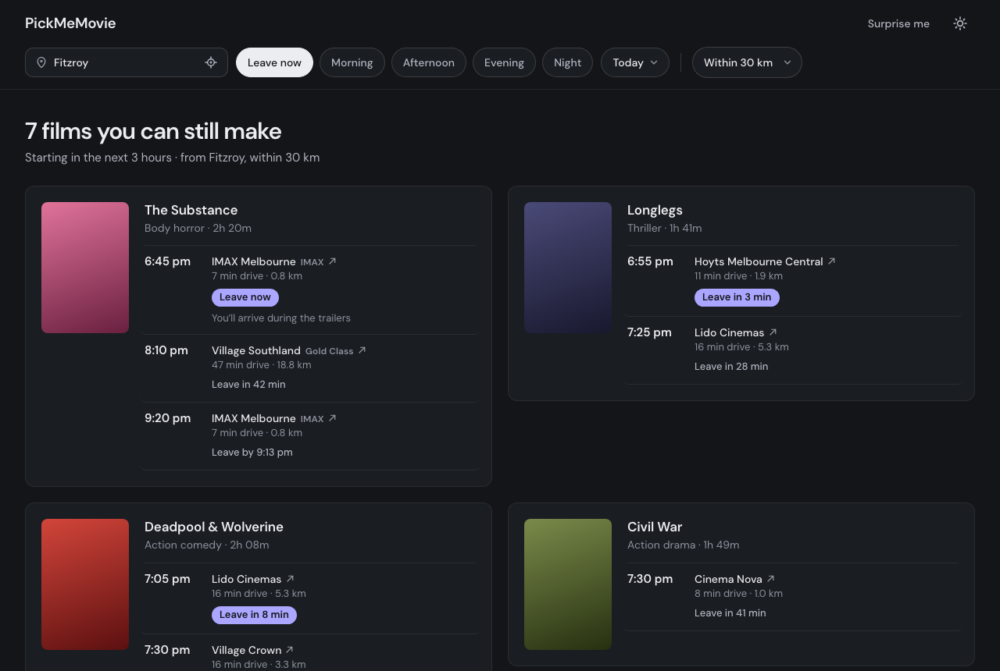

- The day picker was a vague "Today ▾".
- "Morning + afternoon + evening" never said what hours those meant.
- Cards were different heights, so the grid looked messy.
- "Surprise me" ignored *when* you wanted to go.

## 4. Decision log

| # | What I asked for | What the AI pushed back with | What we chose, and why |
|---|---|---|---|
| 1 | A calendar instead of "Today ▾" | Cinemas only publish about 7–10 days ahead, so a month view is mostly dead dates | v6: a 3-week calendar with unpublished days greyed out. **Then I cut it to 3 days** (Today / Tomorrow / day after) as a segmented control. The product is about *soon*, not *someday*. |
| 2 | "How does anyone know what *morning* means?" | Labels hide the hours. Also, combining separate slots ("morning + evening") can't be summed up honestly in one line | One continuous **"starts between X and Y"** window. Presets show their hours ("Evening, 5–9 pm"), and the summary always spells out date and hours. Presets that are already over today are disabled, with a plain-language note. |
| 3 | Leave now = 1 hour (I first had 3) | One hour leaves most cards with a single session, and a quiet suburb at 3 pm often shows nothing | **2 hours.** Leave now became its own mode next to Plan ahead, and it states its window: "starting before 9:40 pm". |
| 4 | — (raised by the AI) | Some sessions start at 12:15 am but are listed under the day before. A hard midnight cut-off would quietly hide them | "Late" runs **9 pm – 1 am**. After-midnight sessions count under the night you go out and are labelled "after midnight". |
| 5 | Let Surprise me pick a timing | Don't add a second set of filters | A **Leave now / your search** switch inside the pick itself. Any option with nothing in it is greyed out. |
| 6 | Should we support public transport? | Easy UI, hard data: needs a transit routing API, timetable-aware times and handling of transfers | **Car only for v1.** Everything says "drive" so nobody reads it as a public transport time. Public transport is a later phase. |
| 7 | — (raised by the AI) | Typing your suburb on every visit is friction | Remember the last location **on the device only**. |
| 8 | Equal card heights | Uneven heights come from uneven content, so give every card the same anatomy | v6: soonest session plus one "N more" line that opens a sheet. Every grid row is forced to the same height. |
| 9 | "Cards get wider when I switch days. I think it's the number of sessions" | **My diagnosis was close but wrong.** The real cause was CSS: plain `1fr` grid columns grow to fit text that can't wrap | One-line fix (`minmax(0, 1fr)`). It was measured, not eyeballed: v7 widths varied (for example 448 px vs 346 px in the same grid); v8 is identical at every size tested. |
| 10 | Card A is best but text-heavy | Some of that heaviness comes from the placeholder posters. Test with real ones first | Pulled the real TMDb posters into the lab, then explored four lighter versions of A (section 5). |
| 11 | Can SerpAPI make it a real app, not just mock data? | Tested first: one search per cinema returns 7 days (~18 films, ~50 sessions a day, with formats like LUX and DBOX). But the free plan is 250 searches a month | **8 cinemas refreshed once a day** (~240 searches a month). Results are cached, so visitors cost nothing, with mock data as a fallback if the quota runs out. A real running app, not a mock-up. |
| 12 | A trailer, without adding complexity | TMDb already returns YouTube trailers in the same call as the film details | A **"Watch trailer"** link in the film sheet only. The cards stay clean. |
| 13 | Genres and details from TMDb | The same call also gives runtime, poster and the Australian rating (e.g. MA 15+) | One cached TMDb lookup per film, matched by title from the showtimes data. |
| 14 | Final card: A1 (keep A3 around) | AI recommended A3 + A1's urgent-only rule; I chose A1 for its minimalism | **A1 Quiet** in v9. A3 stays in the lab as a possible refinement. |
| 15 | "+6 more times" is the wrong word | Agreed. Australian cinemas (Hoyts, Village) call them **sessions**, not showtimes or times | UX copy pass: "sessions" everywhere, "Only session in this window", and a friendlier empty state ("Nothing fits these filters. Try one of these:"). |
| 16 | Trailer and synopsis, but behind a click | Competitive look (IMDb, MUBI GO, Roku, Plex, CGV on Mobbin): film pages lead with a hero plus a Trailer action, and group sessions by cinema. None tell you when to leave | The **whole card opens a film detail view**: a full-screen sheet on phones, a side panel on desktop. It has a backdrop with "Play trailer", the AU rating, runtime, genres, a 3-line synopsis with "More", and sessions grouped by cinema with **estimated end time**, **Directions** and **Book**. The phone back button closes it. |
| 17 | "Show the details in a popup in the middle of the screen, not a sidebar. Better for mobile too" | Phones usually use bottom sheets or full screen, and a centred popup gives up about 24 px of height. Worth checking in a usability test | **v10: one centred popup at every size** (max 640 px wide). The hero with close and trailer stays pinned, and only the details scroll. The v9 side panel left a mostly empty, full-height column on desktop and became a full-screen takeover on tablets. One component instead of two layouts. Surprise me now opens the same way. v9 is kept as the iteration. |

## 5. The card exploration

The card is what people actually look at, so it got its own lab page (`prototypes/cards.html`). Every variant renders the same data. Toggles switch between few and many sessions, the three days, light and dark, and real versus placeholder posters, so each design is tested at its worst case, not its best.

**Round 1: four directions**

| A · List line | B · Session tiles (my idea) |
|---|---|
| 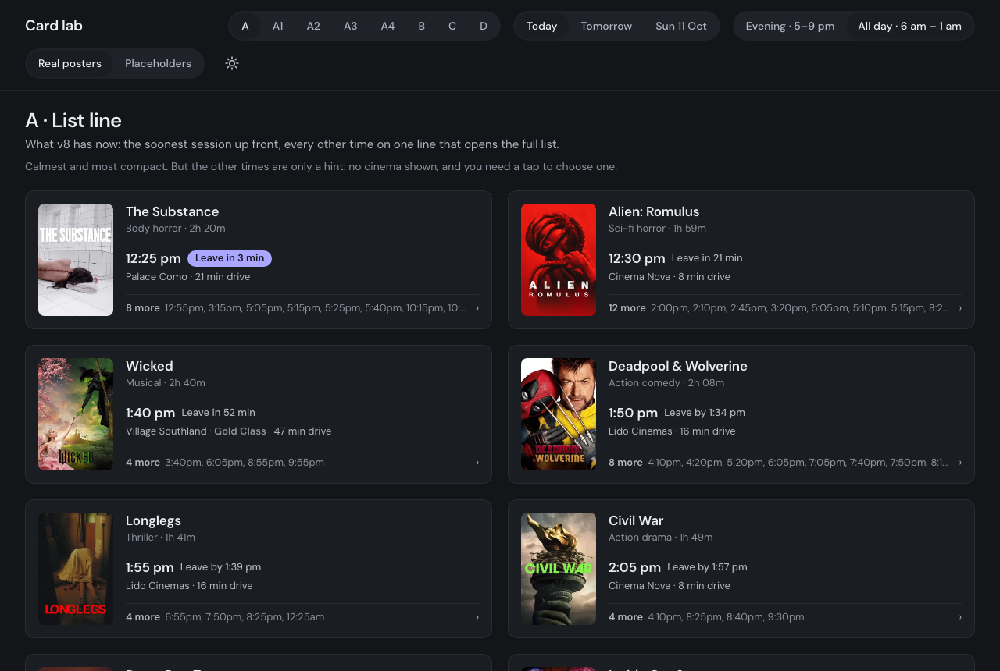 | 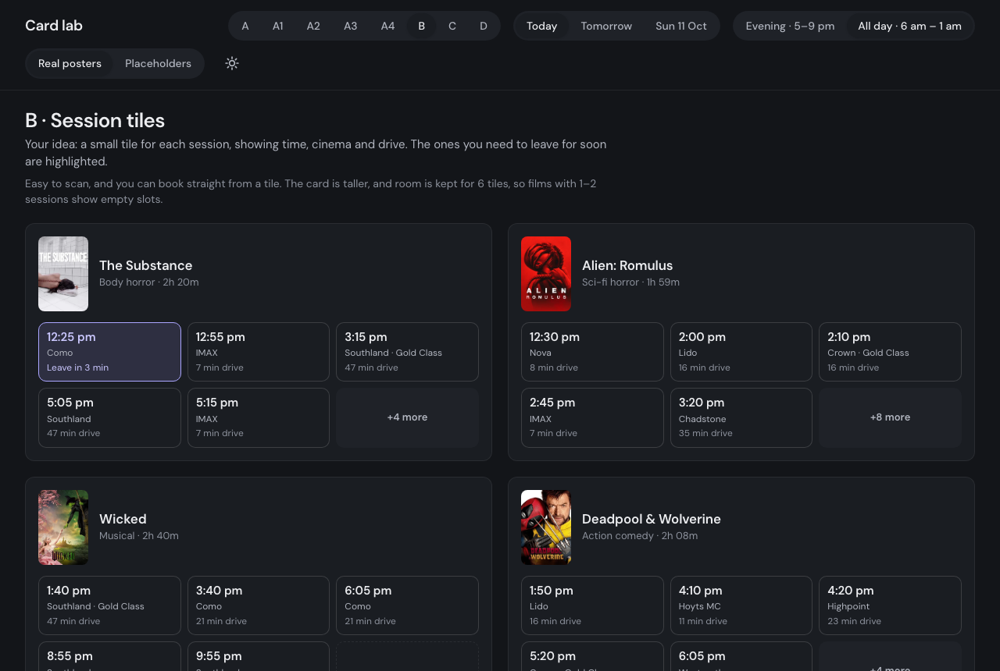 |
| **C · Time strip** | **D · Poster first** |
| 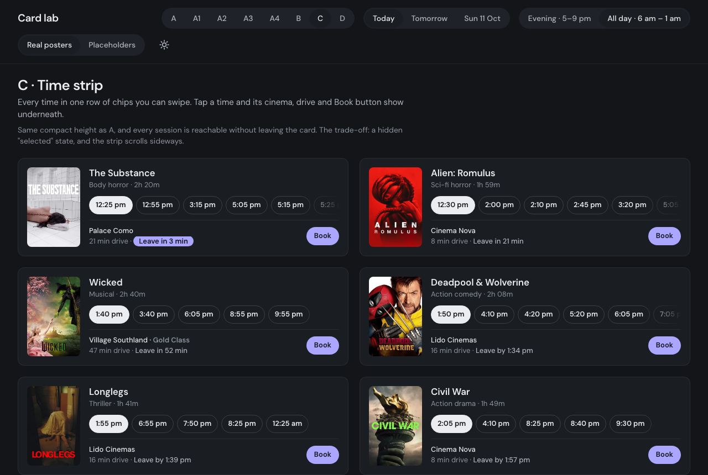 | 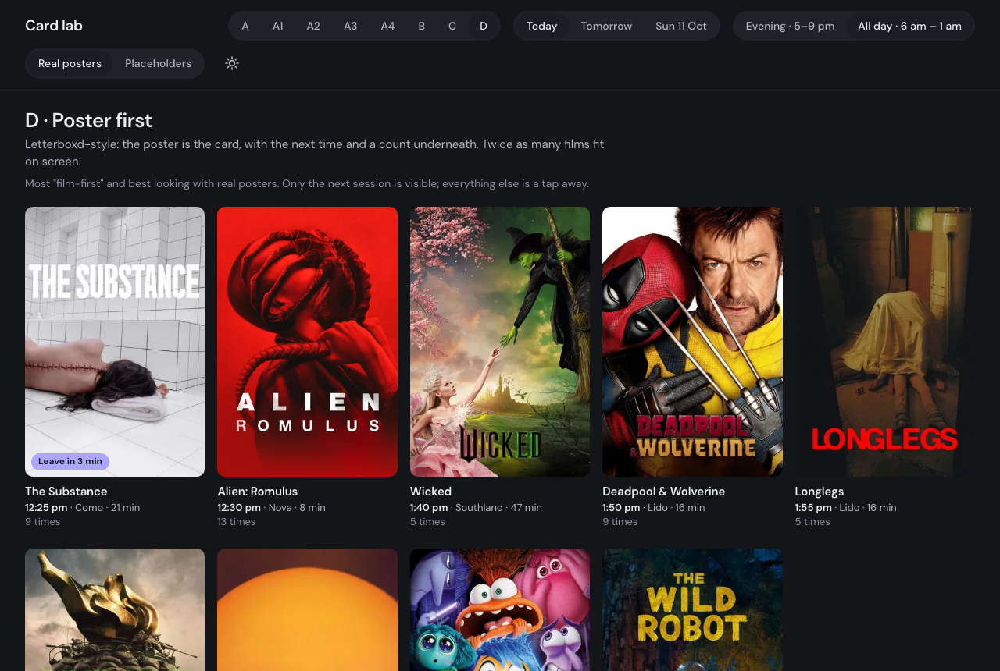 |

- **B** was my sketch idea. It's very scannable, but it reserves room for six tiles, so films with one or two sessions show empty slots.
- **C** was the AI's pick: compact, and every session is reachable inside the card.
- **D** is the most film-first, but it hides the times, and times are the whole point of the product.
- I preferred **A**.

**Real posters versus placeholders.** The same card A, before and after real posters:

| Placeholder | Real TMDb poster |
|---|---|
| 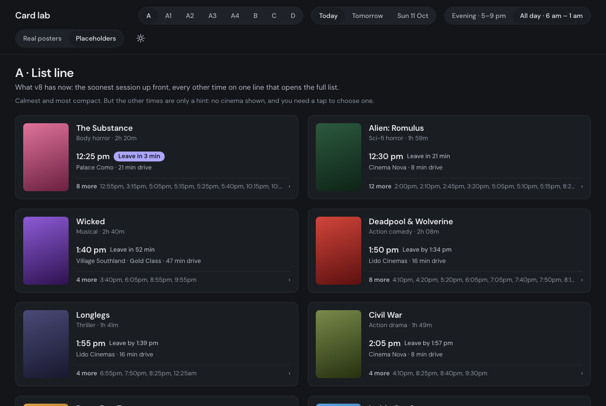 |  |

With real artwork, the poster carries the film's identity, so the text doesn't have to. The lesson: **don't judge density with fake content.**

**Round 2: lighter versions of A**

| A1 · Quiet | A2 · Time-led |
|---|---|
| 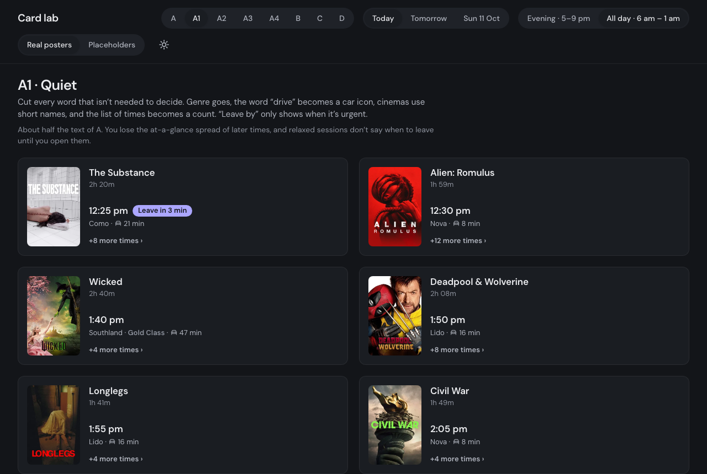 | 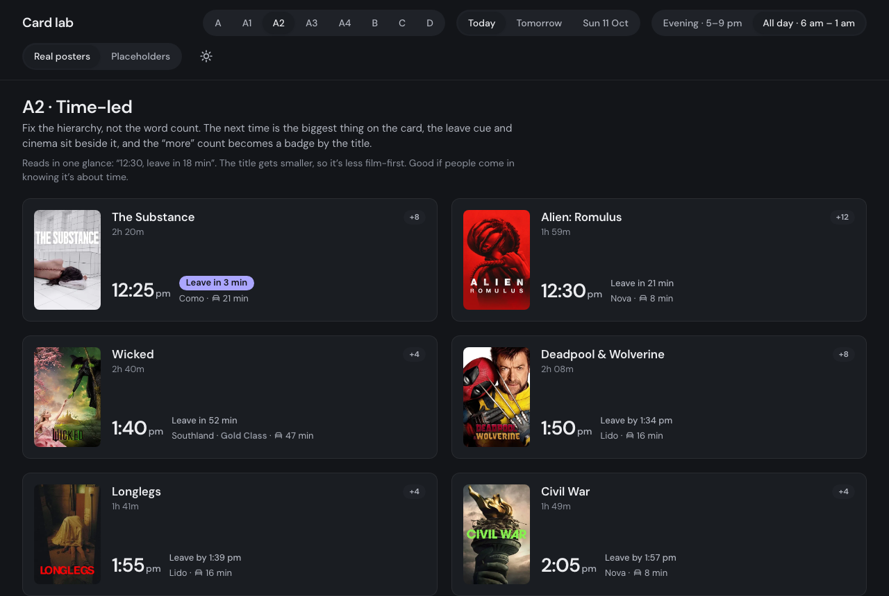 |
| **A3 · A + chips** | **A4 · Timeline** |
| 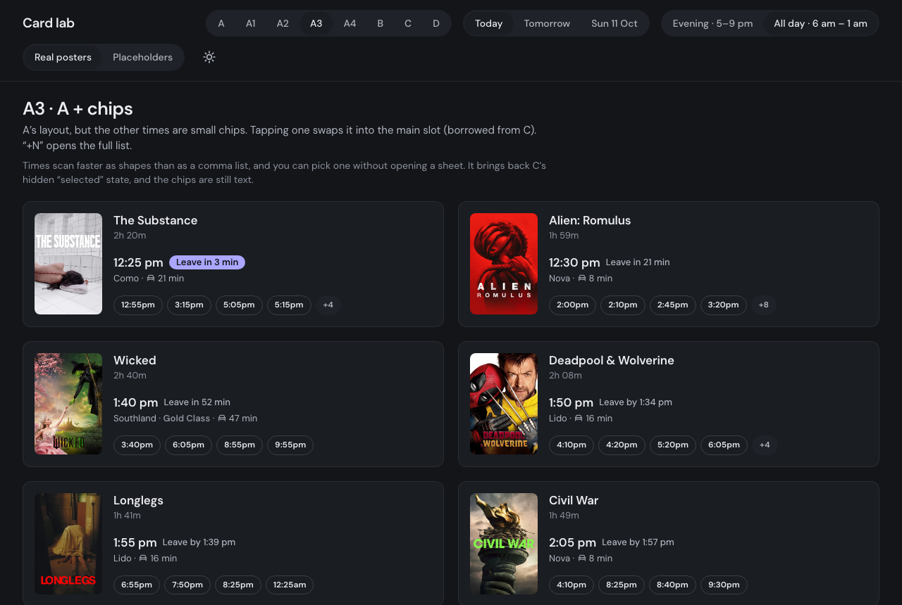 | 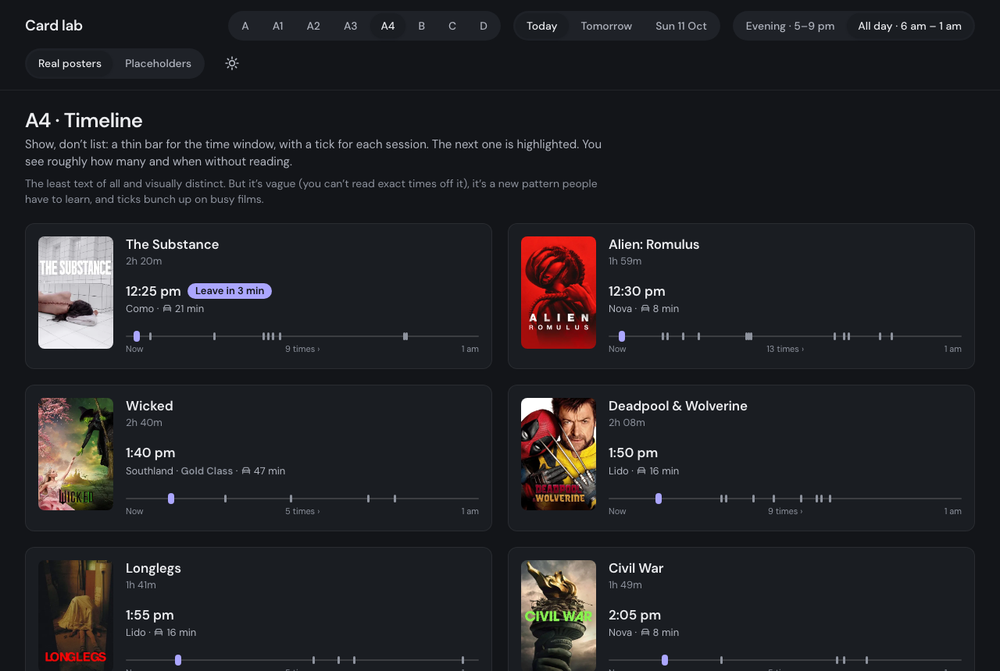 |

- **A1:** cut every word that isn't needed to decide. Short cinema names, a car icon instead of "drive", and the urgent cue only when it's urgent.
- **A2:** fix the hierarchy instead of the word count. The time is the hero.
- **A3:** the other times as tappable chips that swap into the main slot.
- **A4:** a timeline of ticks: the least text, but vague.

**Decision:** **A1 · Quiet**. It's the most minimal, and the detail view now carries everything the card leaves out. A3 is kept as a possible refinement.

**v9: the card opens a film detail view**

| Desktop side panel | Phone sheet (light) |
|---|---|
| 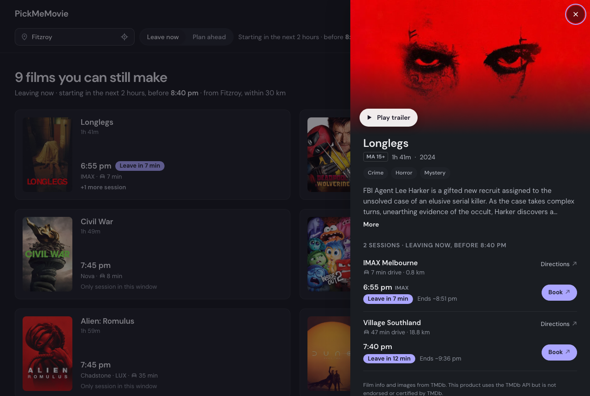 | 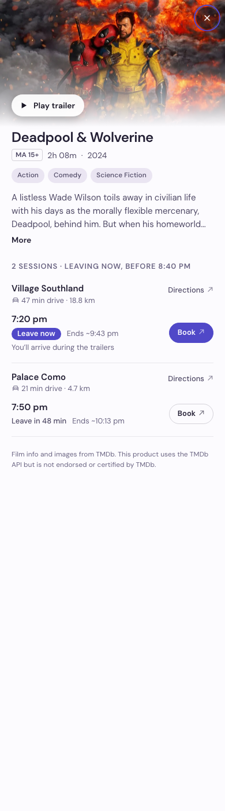 |

**v10: side panel → centred popup (decision 17)**

| v9 · side panel | v10 · centred popup |
|---|---|
| 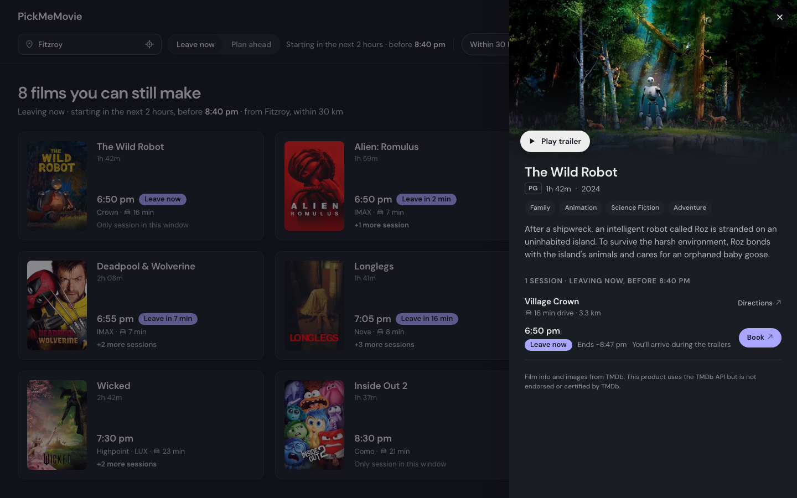 | 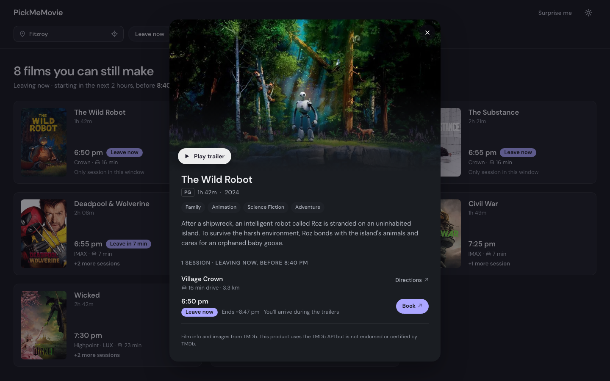 |
| **v10 · tablet (light)** | **v10 · phone (light)** |
| 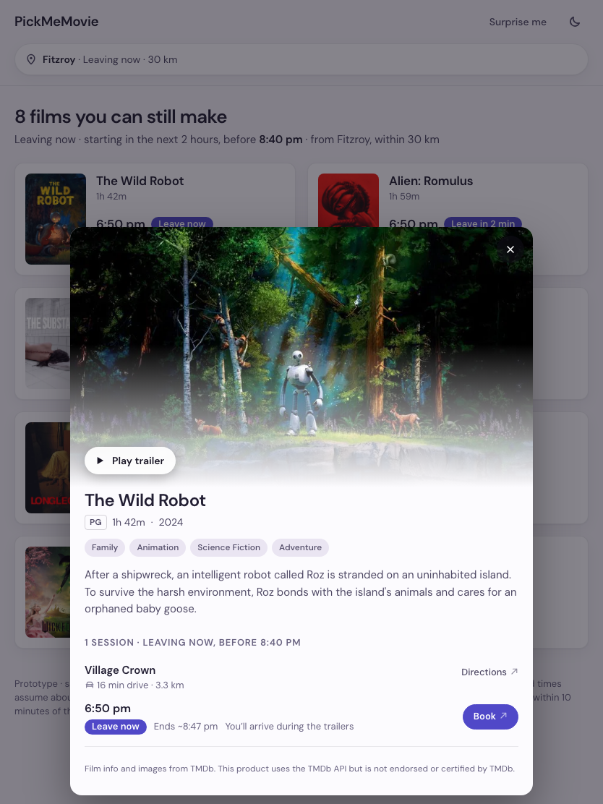 | 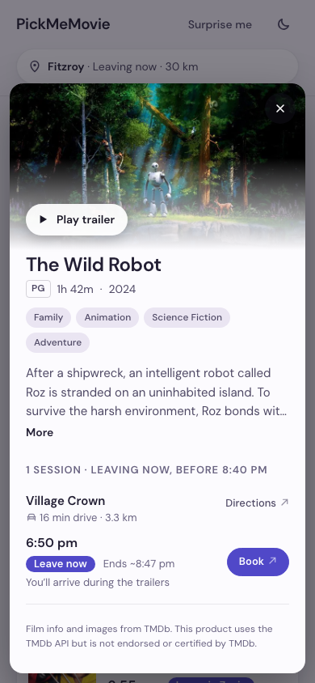 |

Why: one pattern and one component at every size; details open where the eye already is (mid-grid), not at the edge; the dimmed grid behind keeps it feeling like a quick look. Trade-off: slightly less height on phones than a full-screen sheet, so the hero is pinned and only the body scrolls. Every screen at mobile (390), tablet (834) and desktop (1440), in both themes, is in the Figma file (pages 04 and 05).

## 6. What I learned about designing with AI

✏️ *Make this section yours. Draft points from the sessions:*

- **It's best at breadth.** Eight card variants with stress-test toggles in one sitting is something I wouldn't have made by hand. Seeing them side by side made the choice obvious in a way that sketching didn't.
- **Scope is still my job.** The AI over-built the date picker (a 3-week calendar). I'm the one who said "just 3 days". It gave the trade-offs, and I made the product call.
- **Ask it to argue with you.** The most useful moments were pushback: the time window, the after-midnight edge case, real posters before judging density.
- **Describe the symptom, not your theory.** My explanation of the width bug was plausible and wrong. The AI measured it, found the real cause and proved the fix with numbers.
- **Messy input is fine, but check what got through.** I gave most feedback by voice. When part of a message came through garbled, the AI flagged the missing answer instead of making one up.
- **Make it verify.** Screenshots at phone and desktop sizes, plus measurements, after every change. "It should work" wasn't accepted.

## 7. Next

1. ~~Pick the final card~~ Done: A1 in v9, popup detail in v10.
2. Build the Next.js app: SerpAPI for real showtimes (8 cinemas, daily, cached), TMDb for film details and trailers, Geoapify for suburb search and drive times, and the reachability logic carried over from the prototype.
3. Deploy on Vercel and finish this case study with the live link and real usage screenshots.

---

*Film data and posters from TMDb. This product uses the TMDb API but is not endorsed or certified by TMDb.*
